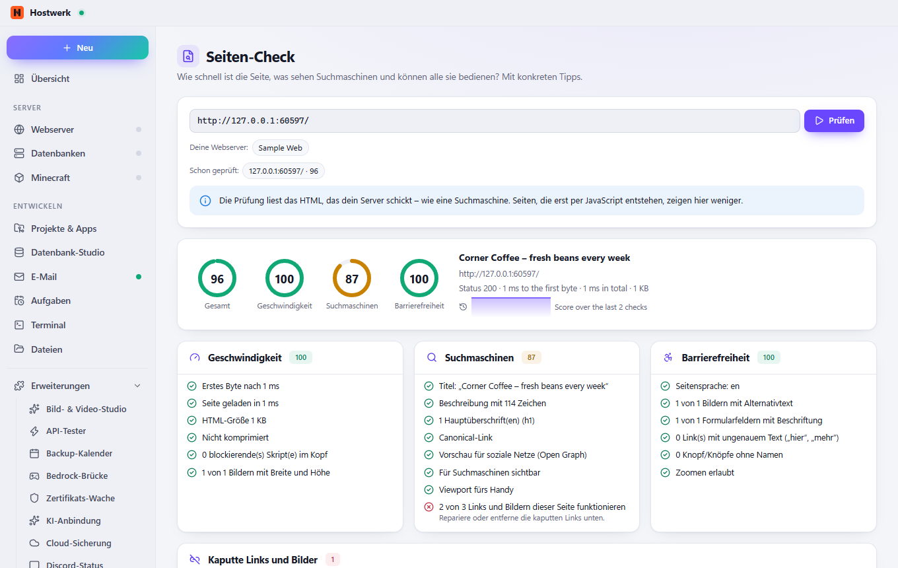

# Seiten-Check

Prüft Seiten deiner Web-Projekte: Ladezeit, Größe, Komprimierung, SEO-Angaben (Titel, Beschreibung, Überschriften), Grundlagen der Barrierefreiheit (Sprache, Bildtexte, Beschriftungen) und kaputte Links auf derselben Seite – mit Punktzahl, konkreten Tipps und Verlauf.

[English](README.md) · Eine offizielle [Hostwerk](https://github.com/Passimoritz/hostwerk-public) Erweiterung (SDK 2.7, native Erweiterung)



## Was sie kann

- Ladezeit (erstes Byte und gesamt), Seitengröße und Komprimierung
- SEO-Grundlagen: Titel, Beschreibung, eine Hauptüberschrift, Canonical-Link, Vorschau für soziale Netze
- Barrierefreiheit-Grundlagen: Seitensprache, Bildtexte, Beschriftungen von Feldern, Linktexte
- Kaputte Links und Bilder auf derselben Seite (bis zu 40 je Prüfung)
- Punkte je Bereich mit verständlichen Tipps, Verlauf je Adresse

## Installieren

In Hostwerk: **Erweiterungen → Entdecken** und „Installieren“ klicken.

Native Erweiterungen laufen als Teil von Hostwerk (eigener Server- und Oberflächen-Teil). Deshalb installiert Hostwerk sie nur aus dem offiziellen Katalog (mit Prüfsumme) oder im Entwickler-Modus.

## Daten

`data/page-check` – die letzten 30 Ergebnisse je Adresse. Beim Entfernen der Erweiterung bleiben sie erhalten.

## Entwickeln

```bash
node --test tests/*.test.js          # Tests
node build-native.js .               # Oberfläche bauen (sdk/build-native.js aus hostwerk-public)
node check.js . --strict             # dieselbe Prüfung wie der Katalog (sdk/check.js)
```

Oberfläche in `ui/src`, Server-Teil in `server/`. Texte im Code sind Englisch, Deutsch steht in `locales/de.json`.

## Lizenz

MIT
