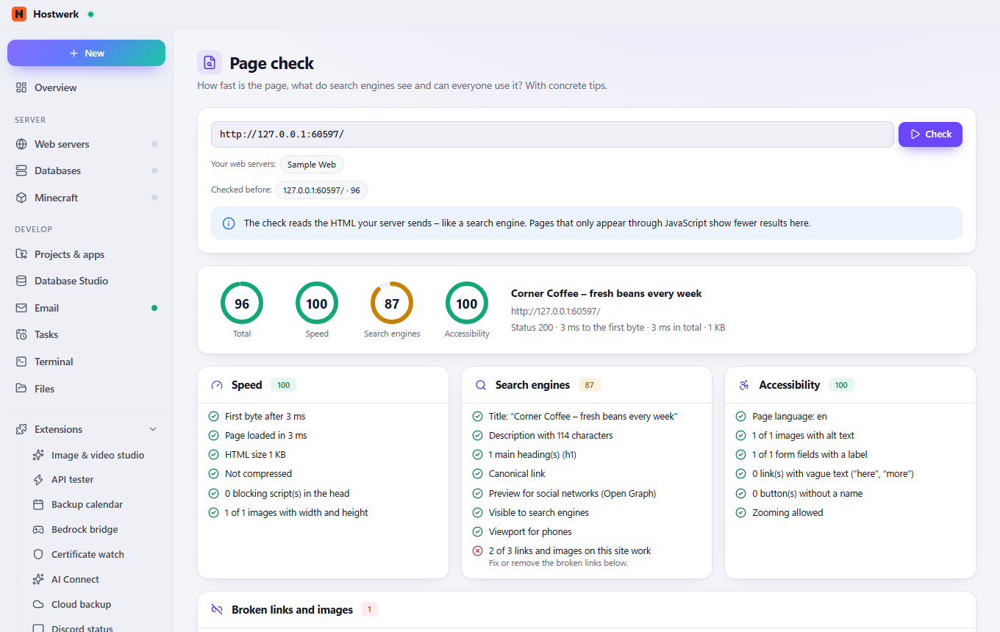

# Page check

Checks pages of your web projects – one at a time or the whole website: speed, SEO, accessibility, security headers and broken links – with a score, concrete tips, history, regular checks and a minimum score before publishing.

[Deutsch](README.de.md) · An official [Hostwerk](https://github.com/Passimoritz/hostwerk-public) extension (SDK 2.7, native extension)



## What it does

- Load time (first byte and total), page size and compression
- SEO: title, description, one main heading, canonical link, social preview, robots.txt (and whether it locks out search engines), sitemap.xml
- Accessibility basics: page language, image texts, form labels, link texts, heading order (h1 first, no skipped levels)
- Security headers: HTTPS (local test addresses excepted), HSTS, Content Security Policy, X-Content-Type-Options, Referrer-Policy, protection against framing
- Broken links and images on the same site (up to 40 per page)
- **Whole website**: follows the links of the site up to N pages (start page included, at most 100) – one row per page, worst first, every link and image checked once
- Score per area with plain tips, history per address
- **Regular checks** (daily or weekly) – a drop of 5 points or more shows up as a message and in Live → Watchers
- **Minimum score before publishing**: other extensions call `host.use('pageCheck').gate(url)` and stop below the score (e.g. “Publish pages”)
- Tab on every project and in the web server area; sits under “Develop” right after the projects; a shortcut “Check a page” to assign under Settings → General → Shortcuts

## For other extensions

```js
const pc = await host.use('pageCheck');
const g = await pc.gate('http://shop.localhost/');   // { ok, score, min, text } – min from the settings, or gate(url, { min: 80 })
const r = await pc.check('http://shop.localhost/');  // full result, also kept in the history
```

## Install

In Hostwerk: **Extensions → Discover** and click “Install”.

Native extensions run as part of Hostwerk (own server and interface part). That is why Hostwerk only installs them from the official catalogue (with checksum) or in developer mode.

## Data

`data/page-check` – the last 30 results per address, the last 10 website checks and the settings (regular checks, minimum score). Removing the extension keeps them.

## Develop

```bash
node --test tests/*.test.js          # tests
node build-native.js .               # build the interface (sdk/build-native.js from hostwerk-public)
node check.js . --strict             # same check as the catalogue (sdk/check.js)
```

Interface source in `ui/src`, server part in `server/`. Texts in the code are English, German is in `locales/de.json`.

## License

MIT
